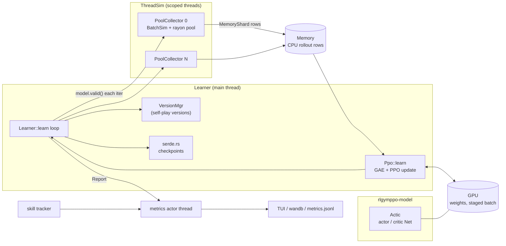
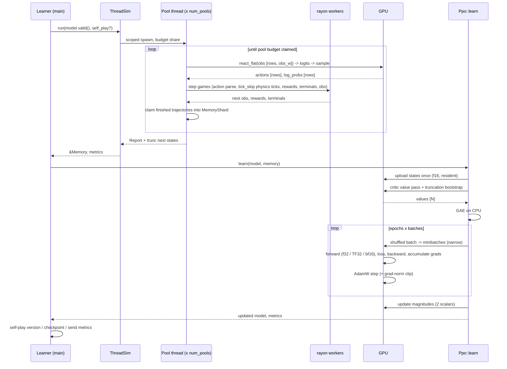

# indococo-ppo

`indococo-ppo` is a PPO trainer for Rocket League bots, written in Rust. It is
a fork of [VirxEC/rlgymppo_rs](https://github.com/VirxEC/rlgymppo_rs) that adds
learner-side speedups so the Indonesian Coconut bot trains faster on one
NVIDIA GPU. The framework itself is VirxEC's work; see [Credits and
license](#credits-and-license).

## Speedup at a glance

**About 1.7x faster than upstream rlgymppo_rs: 40.8k → 70.1k steps/s with
the recommended LibTorch TF32 + bf16 critic.**

| Configuration | Steps/s |
|---|---|
| Upstream `86bd822` (Burn CUDA f32) | 40.8k |
| + GPU update magnitudes | 43.8k |
| LibTorch TF32 | 57.9k |
| LibTorch TF32 + bf16 critic (**recommended**) | **70.1k** |
| LibTorch TF32 + bf16 critic and policy | 80.7k (off by default: raises the KL estimate ~5x) |

Setup: g6.8xlarge (1 NVIDIA L4, 16-core/32-thread AMD EPYC 7R13). Every row
uses the same 1v1 config: 2048-2048-1024-1024 actor and critic, 2 epochs,
100k steps per iteration, 50k minibatch, 512 games, 2 pools × 12 threads,
training from scratch, median of iterations 4-10. Sustained training runs
(self-play, warm-started) hold about 62-76k steps/s. Full table, method and
roadmap: [Performance](#performance).

Contents:

0. [Speedup at a glance](#speedup-at-a-glance)
1. [Credits and license](#credits-and-license)
2. [Differences from upstream](#differences-from-upstream)
3. [Architecture](#architecture)
4. [Backends and precision](#backends-and-precision)
5. [Configuration flags](#configuration-flags)
6. [Performance](#performance)
7. [Install and usage](#install-and-usage)
8. [Development](#development)
9. [Upstream README](#upstream-readme)

## Credits and license

- Framework: [rlgymppo_rs](https://github.com/VirxEC/rlgymppo_rs) by VirxEC
  and contributors, a Rust port of GigaLearn. This repository keeps its full
  git history; `upstream` points at it for rebases.
- Speed ideas (bf16 autocast, values from rollout inference, CUDA graphs; see [Roadmap](#roadmap-next-optimizations))
  come from buta-ppo (MIT). No buta-ppo code is included yet.
- Simulation: RocketSim v3 through [RLGym-rs](https://github.com/VirxEC/rlgym_rs).
  Tensors and autodiff: [Burn](https://burn.dev) 0.22.
- License: **GPL-2.0**, inherited from upstream (see `LICENSE`). If you
  distribute a binary built from this code, you must also offer its source.

## Differences from upstream

Forked from upstream commit `86bd822`. Every change keeps upstream numerics by
default; faster numerics are opt-in.

| Change | Files | Default | Why |
|---|---|---|---|
| Update-magnitude metrics computed on the GPU | `rlgymppo/src/agent/update_magnitude.rs` | Always on | Upstream downloaded all ~15.6M weights to the CPU twice per iteration (~60 ms). Now it keeps tensor handles (no copy) and reads back two scalars. |
| bf16 mixed precision per network for the PPO update | `rlgymppo-model/src/precision.rs`, `Net::forward_with`, `PpoLearnerConfig::precision` | Off (f32) | bf16 matmuls are ~2-3x faster on Ada/Ampere GPUs. |
| Clipped PPO loss in its own tested module | `rlgymppo/src/agent/ppo_loss.rs` | No behaviour change | Readability and unit tests. |
| Clippy fixes (`render.rs`, removed unused `GameInstance::step_vis`) | `rlgymppo/src/environment/` | No behaviour change | `clippy -D warnings` passes. |
| CI: rustfmt, clippy, CPU tests | `.github/workflows/ci.yml` | n/a | |
| Documented LibTorch + TF32 training | this README | Opt-in via the existing `torch` feature | LibTorch's cuBLAS TF32 path is ~1.8x faster per training step than Burn CUDA f32. |
| External (non-`Actic`) frozen opponents in the self-play pool | `rlgymppo/src/agent/external.rs`, `BatchSim::external_decision`, `GameInstance::step_external` | Off (empty `external_opponents`) | Train against a foreign bot with its own obs, action table and action delay (e.g. a GigaLearn bot ported to Rust). See [External opponents](#external-opponents). |

Not adopted yet, with reasons, in [Roadmap](#roadmap-next-optimizations).

## Architecture

### Workspace layout

| Crate | Owns |
|---|---|
| `rlgymppo` | The learner: `Learner` (training loop, checkpoints, self-play, metrics fan-out), `Ppo` (GAE + PPO update), the collectors (`ThreadSim` → `PoolCollector` → `BatchSim`), and the rollout `Memory`. |
| `rlgymppo-model` | Device-agnostic networks: `Net` (MLP), `Actic` (actor, critic, optional shared head), action sampling, `ComputePrecision`/`TrainPrecision`, and `Policy` for inference-only loading. |
| `rlgymppo-utils` | Learner-independent RLGym pieces: `DefaultObs`, `AdvancedObs`, `DefaultAction` (90-action lookup table), rewards, terminals, state setters, `Report`/`AvgTracker` metrics. |
| `rlgymppo-nexto` | Nexto's model, obs and action table, used as a fixed skill-tracker opponent. |
| `rlgymppo-rlbot` | RLBot v5 agent that runs an exported policy on Burn Flex (CPU). This is the deploy path, including Windows. |
| `rlgymppo-tui` | ratatui dashboard. |
| `rlgymppo-wandb` | Weights & Biases sender (pyo3). |
| `rlgymppo-trainer`, `rlgymppo-transfer` | Example binaries. |

Modules inside `rlgymppo/src`:

| Module | Owns |
|---|---|
| `lib.rs` | `LearnerConfig`, `Learner::learn` (the iteration loop), metrics actor thread, stdin controls, checkpoint cadence. |
| `agent/mod.rs` | `Ppo::learn`: staging the rollout on the device, value pass, truncation bootstrap, GAE, shuffled minibatches, gradient accumulation, optimizer steps, metrics. |
| `agent/ppo_loss.rs` | Clipped surrogate, entropy, KL estimate, clip fraction. |
| `agent/update_magnitude.rs` | GPU-side parameter snapshots for `Update/* magnitude`. |
| `agent/gae.rs` | GAE, return standardisation, reward clipping (CPU, f32). |
| `agent/config.rs` | `PpoLearnerConfig` and its sub-configs, optimizer factory. |
| `agent/self_play.rs` | Saving old policy versions and picking self-play opponents. |
| `agent/skill_tracker.rs` | Elo ratings against old versions and Nexto. |
| `agent/transfer_learn.rs` | Teacher → student distillation (not used by the 1v1 bot). |
| `environment/thread_sim.rs` | `ThreadSim`: splits the step budget across pools and runs them on scoped threads. |
| `environment/pool_collector.rs` | `PoolCollector`: one `BatchSim` plus its own rayon pool and budget share. |
| `environment/batch_sim.rs` | `BatchSim`: the per-pool step loop (inference, physics, rewards, trajectory claiming). |
| `environment/sim.rs` | `GameInstance`: one RocketSim arena with its state setter, obs, action parser, rewards and terminals. |
| `base/memory.rs` | `Memory`: flat row-major rollout buffers and `MemoryShard` writers. |
| `utils/serde.rs` | Checkpoint folders (`actor.bpk`, `critic.bpk`, `stats.toml`, optimizer state). |

### Component diagram



### One iteration, end to end



### Data pipeline

1. **Environment threads.** `ThreadSim` owns `num_pools` `PoolCollector`s.
   Each iteration it splits `timesteps_per_iteration` across pools and runs
   each on a `std::thread::scope` thread. A pool owns `num_games_per_pool`
   `GameInstance`s (one RocketSim `Arena` each) and a private rayon pool of
   `num_threads_per_pool` workers that step games in parallel.
2. **State setters and terminals.** On reset a `GameInstance` applies its
   `StateSetter` (e.g. `WeightedState` of kickoff and random states). After
   each step its `Terminal` (goal, game end) and `Truncate` (no-touch timeout,
   `max_episode_length`) decide whether the episode ends, and whether it ends
   as *terminal* (bootstrap 0) or *truncated* (bootstrap from the next state's
   value).
3. **Observation builder.** The env's `Obs` implementation builds one f32 row
   per player into the pool's flat `next_obs` buffer (`[players, obs_w]`).
   For Indonesian Coconut 1v1 this is a Rust port of RLGym's `DefaultObs`
   (`obs_w = 92`, parity-checked to 6e-8 against Python).
4. **Batched policy inference.** The pool thread uploads `next_obs` as one
   f32 tensor `[players_in_pool, obs_w]` to the training device, runs the
   actor (no autodiff, f32) to masked logits `[players, n_actions]`, samples on
   the device and reads back actions and log-probs. With
   `action_delay == 0` this is synchronous (`react_flat`); with a delay the
   submit is overlapped with the delayed physics phase (`submit_react_flat` +
   `wait`). Each pool runs its own inference, so with two pools the GPU sees
   two independent streams of small batches.
5. **Action parsing.** `Action::parse_actions` maps each index to
   `CarControls` through the lookup table (90 actions for `DefaultAction`) and
   the env repeats them for `tick_skip` physics ticks (8 for the bot).
6. **Rewards.** After the ticks, `Reward::get_rewards` returns one f32 per car,
   usually a `combined_rewards!` weighted sum; components named `Reward/*`
   are sampled into metrics every `reward_sample_interval` steps.
7. **Rollout buffer.** Finished (or budget-cut) trajectories are claimed into
   `MemoryShard`s, which are disjoint row ranges of one `Memory`. Everything is
   flat, row-major, in host RAM (see the shapes table). Truncated rows also
   store the next observation in `trunc_next_states`.
8. **Staging.** `Ppo::learn` converts the states to f16 in parallel and uploads
   them once; they stay resident on the GPU for the whole update. Each slice is
   cast back to f32 right before it enters a network.
9. **Values and GAE.** The critic runs over the resident states in
   `gpu_timestep_buffer_size` chunks, and over `trunc_next_states` for the
   truncation bootstrap, each read back in one transaction. GAE (γ, λ),
   reward clipping and return standardisation run on the CPU in f32.
10. **Minibatching.** Each epoch shuffles row indices, gathers a
    `batch_size` batch on the GPU (`select`), and slices it into
    `mini_batch_size` minibatches with zero-copy `narrow`. Gradients are
    accumulated across a batch's minibatches, weighted by size, then one
    optimizer step is taken per batch.
11. **PPO update.** Per minibatch: `Actic::forward_with` (precision per
    network), `clipped_policy_loss` (surrogate with per-sample clip bounds,
    entropy bonus, KL estimate, clip fraction) and an MSE value loss against the
    GAE targets. Loss = policy loss − entropy_scale · entropy + value loss.
    The optimizer is AdamW per network (actor, critic, shared head) with
    gradient-norm clipping (0.5 by default) and optional separate learning
    rates and LR schedule.
12. **Weight sync.** There is no copy: collectors and learner share the same
    device. Each iteration the learner hands `model.valid()` (a non-autodiff
    view of the same parameters) to the collectors.
13. **Checkpointing.** Every `timesteps_per_save` steps the learner writes
    `checkpoints/<timesteps>/{actor,critic[,shared_head]}.bpk`, `stats.toml`
    (counters and return statistics) and the optimizer state, keeping
    `checkpoints_limit` folders. Self-play versions go under
    `policy_versions/`. Models are always stored in f32.
14. **Metrics.** Each iteration's `Report` goes over an mpsc channel to a
    metrics actor thread that fans out to the TUI, wandb (its own thread,
    bounded channel) and `metrics_jsonl`.
15. **Export and deploy.** The actor can be written to safetensors with
    PyTorch key names (`burn-store`, `BurnToPyTorchAdapter`) for Python
    tooling, or loaded directly by `rlgymppo-rlbot`, which runs it on Burn
    Flex on the CPU. Training precision never reaches the deploy path, so
    Windows RLBot builds need no GPU or LibTorch.

### Shapes and placement (Indonesian Coconut 1v1, 512 games, 100k steps per iteration)

| Data | Shape | dtype | Lives on |
|---|---|---|---|
| Pool inference input | `[256 games × 2 players, 92]` | f32 | uploaded per step to the GPU |
| Logits / log-probs | `[512, 90]` | f32 | GPU, sampled there |
| Actions, sampled log-probs | `[512]` | i64 → `usize`, f32 | read back to the pool thread |
| `Memory::states` | `[100k × 92]` flat | f32 | host RAM (~37 MB) |
| `Memory::actions`, `log_probs`, `rewards`, `terminals` | `[100k]` | usize, f32, f32, u8 | host RAM |
| `Memory::action_masks` | `[100k × 90]` flat | u8 | host RAM |
| `Memory::trunc_next_states` | `[n_truncated × 92]` | f32 | host RAM |
| Resident states | `[100k, 92]` | f16 | GPU (~18 MB) |
| Old values, advantages, returns | `[100k]` | f32 | CPU (GAE), uploaded with the batch |
| Training minibatch | `[50k, 92]` | f32 (bf16 inside matmuls when enabled) | GPU |
| Actor | 92 → 2048 → 2048 → 1024 → 1024 → 90 | f32 params | GPU (7.8M params) |
| Critic | 92 → 2048 → 2048 → 1024 → 1024 → 1 | f32 params | GPU (7.7M params) |

### External opponents

`SelfPlayConfig::external_opponents` holds frozen policies that are not an
`Actic`: anything implementing `ExternalPolicy` (`action_delay`, `obs_width`,
`num_actions`, `build(state, car, obs, mask)`, batched `infer`, `controls`).
They are drawn by weight together with the past versions and the fixed
opponents (`OpponentPick::External`). In such an iteration the collector
(`BatchSim::external_decision`):

1. submits the learner's rows (tracked team) to the GPU as usual;
2. meanwhile builds the external obs and masks from each game's
   `GameState`, one rayon job per game;
3. runs one batched `infer` for all external rows;
4. steps each game with `GameInstance::step_external`: the external cars keep
   their current controls for `action_delay` ticks, then the new action for
   the rest of the tick skip (GigaLearn's `actionDelay = tickSkip - 1`).

External players get action 0 and log prob 0 and are not recorded (they are
untracked, like any opponent). The learner must not use an action delay itself.

### Threading and synchronization

| Thread | Work | Talks to |
|---|---|---|
| Main | `Learner::learn`: collection call, `Ppo::learn`, checkpoints | everything below |
| Pool threads (`num_pools`, scoped per iteration) | Drive one `BatchSim`: inference on the GPU, then dispatch physics | own rayon pool; joined by `ThreadSim` |
| Rayon workers (`num_threads_per_pool` per pool) | Step games, compute obs, rewards and terminals | write disjoint `MemoryShard` ranges, no locks |
| Metrics actor | Aggregates `Report`s | mpsc from main and skill tracker |
| wandb sender | Python wandb calls | bounded `sync_channel(1)` |
| stdin reader | Pause, save, render controls | mpsc to main |
| Skill tracker | Elo matches (sync or async) | mpsc metrics |

Synchronization points per iteration: pool threads join at the end of
collection (the only barrier between physics and learning, so collection and
learning are sequential); each inference call reads back actions (one GPU
sync per pool step); the value pass and truncation bootstrap each use one
transaction readback; the PPO metrics and update magnitudes are read back once
at the end of the update. Collection and learning do not overlap.

## Backends and precision

Burn 0.22 dispatches at runtime from a `Device`; the cargo features decide
which backends are compiled in.

| Backend | Feature | Use | Notes |
|---|---|---|---|
| Burn CUDA (cubecl) | `cuda` | Default GPU backend | f32 GEMMs are fine, but the full training step is ~1.8x slower than cuBLAS TF32. |
| Burn CUDA + fusion | `cuda`, `fusion` | Kernel fusion | 9% faster in a microbenchmark, no measurable end-to-end gain. Not recommended. |
| LibTorch | `torch` (`burn-tch`) | **Recommended for training** | cuBLAS kernels. Set `TORCH_ALLOW_TF32_CUBLAS_OVERRIDE=1` for TF32 matmuls. Needs PyTorch/LibTorch 2.9 (`tch` 0.22). Linux training only. |
| Burn Flex | `flex` | CPU: tests, CI, RLBot deploy | Works on Windows. |
| wgpu, Metal, ROCm | `wgpu`, `metal`, `rocm` | Other GPUs | Untested in this fork. |

Precision (`PpoLearnerConfig::precision`, training step only):

- `ComputePrecision::F32` (default): plain f32, or TF32 when the LibTorch
  override is set.
- `ComputePrecision::Bf16`: autocast-style. Activations and weights are cast
  to bf16 for each matmul and bias add; parameters stay f32 (they are the
  optimizer's master weights); layer norms run in f32; the network output is
  cast back to f32, so log-softmax, ratios and losses are always f32.
  Gradients flow back through the casts into the f32 parameters.

Recommended: **bf16 critic, f32 policy**. In a warm-started A/B with the same
learning rate, a bf16 policy raised the KL estimate about 5x (0.002 → 0.010)
and the clip fraction from ~1-2% to ~6%, because bf16 rounding perturbs the
probability ratio. A bf16 critic only adds noise to the value targets.

## Configuration flags

Fork additions and the flags that matter for speed. All other
`PpoLearnerConfig` and `LearnerConfig` fields are unchanged from upstream and
documented on the structs.

| Flag | Default | Effect |
|---|---|---|
| `PpoLearnerConfig::precision.policy` | `F32` | Actor matmul precision in the update. |
| `PpoLearnerConfig::precision.critic` | `F32` | Critic matmul precision in the update. |
| `LearnerConfig::device` | default device + autodiff | Pick `Device::libtorch_cuda(0).autodiff()` for LibTorch. |
| `TORCH_ALLOW_TF32_CUBLAS_OVERRIDE` env | unset | `1` enables TF32 on the LibTorch backend. |
| `timesteps_per_iteration` / `batch_size` / `mini_batch_size` | 60k / 60k / 20k | Rollout size, optimizer-step size, forward/backward chunk. |
| `gpu_timestep_buffer_size` | 60k | Chunk size of the value pass. |
| `epochs` | 3 | Passes over each rollout. |
| `num_pools`, `num_threads_per_pool`, `num_games_per_pool` | see `LearnerConfig` | Collection parallelism; 2 pools × 12 threads × 256 games is the bot's setup. |
| cargo `fusion` | off | Burn kernel fusion. |

## Performance

1v1, 2048-2048-1024-1024 actor and critic, 2 epochs, 100k steps per
iteration, 50k minibatch, 512 games, 2 pools × 12 threads, idle NVIDIA L4
(g6.8xlarge), training from scratch, median of iterations 4-10.

| Stage | Configuration | Steps/s | Learn time / iter |
|---|---|---|---|
| Baseline | Upstream `86bd822`, Burn CUDA f32 | 40.8k | 1.88 s |
| 0 | + GPU update magnitudes | 43.8k | 1.76 s |
| 0 | + Burn `fusion` | 43.3k | 1.76 s |
| 1 | LibTorch f32 | 37.6k | 2.24 s |
| 1 | LibTorch TF32 | 57.9k | 1.29 s |
| 2 | LibTorch TF32 + bf16 critic (**recommended**) | 70.1k | 1.03 s |
| 2 | LibTorch TF32 + bf16 critic and policy | 80.7k | 0.79 s |
| 2 | Burn CUDA + bf16 critic and policy | 72.1k | 0.80 s |

Warm-started from the real 1v1 policy with self-play, the recommended setup
held ~76k steps/s over 150M steps. buta-ppo reaches ~111k at this net size.

To benchmark: run a trainer with `num_additional_iterations` and
`metrics_jsonl` set on an otherwise idle GPU and compare the medians of
`Throughput/overall` and `Timing/consumption`, skipping the first three
iterations.

### Roadmap (next optimizations)

Stages 1–2 (bf16 autocast for the critic, TF32, the resident-state update
pipeline) are done. Planned next, in order:

- [ ] **Stage 3: value reuse with fused graphs.** Return values from the
  rollout inference pass instead of a separate critic pass over the
  rollout. That pass costs about 0.08 s per 100k steps (about 6% of an
  iteration). Done naively, it adds a critic forward to every small
  inference batch, which costs about as much as the actor's 0.28 s of
  collection inference. It only pays off with actor and critic fused into
  one captured graph (stage 4).
- [ ] **Stage 4: CUDA graphs for collection inference.** Capture the
  fixed-shape policy (and critic) forward once and replay it each step, to
  cut kernel-launch and dispatch overhead on the small batches. Burn
  doesn't expose this, so it needs LibTorch graph capture through `tch`.
- [ ] **Stage 5: GPU-resident rollout buffer.** Write observations,
  actions, log-probs and values straight into preallocated device tensors
  during collection, instead of staging on the host and uploading once per
  iteration (about 0.5 s of upload per 100k steps today).
- [ ] Overlap collection with learning (double-buffered rollouts).

Benchmark each stage with the method above against the current median
(about 75k sps on an L4 in the 1v1 bot, 4×[2048, 2048, 1024, 1024]).

## Install and usage

Requirements: Rust stable (edition 2024), RocketSim `collision_meshes/` next
to the binary, and for the LibTorch backend a PyTorch 2.9 install.

```toml
[dependencies]
rlgymppo = { git = "https://github.com/SentientPlatypus/indococo-ppo", default-features = false, features = ["cuda", "torch"] }
```

```rust
use rlgymppo::{ComputePrecision, LearnerConfig, PpoLearnerConfig, TrainPrecision};

let device = Device::libtorch_cuda(0);
let config = LearnerConfig {
    device: device.clone().autodiff(),
    render_device: device,
    ppo: PpoLearnerConfig {
        precision: TrainPrecision {
            policy: ComputePrecision::F32,
            critic: ComputePrecision::Bf16,
        },
        ..Default::default()
    },
    ..Default::default()
};
```

```sh
export LIBTORCH_USE_PYTORCH=1            # or LIBTORCH=/path/to/libtorch
export TORCH_ALLOW_TF32_CUBLAS_OVERRIDE=1
cargo run --release
```

The rest of the API (envs, rewards, self-play, checkpoints, RLBot deploy) is
upstream's and is described in the upstream README below.

## Development

```sh
cargo +nightly fmt --check   # rustfmt.toml uses nightly-only options
cargo clippy -p rlgymppo -p rlgymppo-model --no-default-features --features flex --all-targets -- -D warnings
cargo test -p rlgymppo -p rlgymppo-model --no-default-features --features flex
# LibTorch backend tests
LIBTORCH_USE_PYTORCH=1 cargo test -p rlgymppo --no-default-features --features torch --lib torch_
```

Environment tests need `collision_meshes/` at the workspace root (it is
gitignored); CI skips them. To pick up upstream work:
`git fetch upstream && git rebase upstream/master`.

---

## Upstream README

## rlgymppo-rs

A Rust implementation of Proximal Policy Optimization (PPO) for Rocket League
training, built on [RocketSim v3](https://github.com/ZealanL/RocketSim/tree/v3-rust) +
[rocketsim_viewer](https://crates.io/crates/rocketsim_viewer) via
[RLGym-rs](https://github.com/VirxEC/rlgym_rs).

For an existing bot, see the [downstream migration guide](MIGRATING_DOWNSTREAM.md).
It covers RocketSim 0.3, the replacement for RLViser, Docker viewer networking,
and Burn 0.22.

### Project structure

The workspace is split into nine crates:

| Crate | Purpose |
|---|---|
| `rlgymppo` | Core PPO learner, multi-threaded environment runner, and training loop. |
| `rlgymppo-model` | Runtime-device policy/model definitions and checkpoint-compatible inference loading. |
| `rlgymppo-nexto` | Nexto model inference, observation builder, action table, and pre-generated model weights. |
| `rlgymppo-rlbot` | RLBot v5 agent that runs trained policies with Burn Flex and RocketSim state enrichment. |
| `rlgymppo-utils` | Reusable RLGym observation builders, action parsers, and shared-info traits, without depending on the PPO learner. |
| `rlgymppo-tui` | Terminal-based dashboard that renders live training metrics (ratatui). |
| `rlgymppo-wandb` | Weights & Biases integration via an embedded Python interpreter (pyo3). |
| `rlgymppo-trainer` | Bundled training example with shared logic, self-play, and skill tracking. |
| `rlgymppo-transfer` | Transfer-learning example that pretends `rlgymppo-trainer` is the parent model. |

`rlgymppo-utils` contains the shared `DefaultObs`, `AdvancedObs`, and
`DefaultAction` implementations used by the trainer. It re-exports `rlgym` and
RocketSim types so inference applications can reuse the same observation and
action logic without depending on the PPO training stack.

### Quick start

Burn 0.22 requires Rust 1.95 or later.

See [`rlgymppo-trainer/examples/run.rs`](rlgymppo-trainer/examples/run.rs) for a
complete training example. The core logic lives in
[`rlgymppo-trainer/src/lib.rs`](rlgymppo-trainer/src/lib.rs). It includes:

- A custom `SharedInfo` that tracks player metrics (distance to ball, speed,
  boost, air time, demo status, touch height)
- 1v1, 2v2, and 3v3 random game selection
- Several state setters (kickoff, random positions) weighted by probability
- Combined rewards (air time, face ball, velocity to ball)
- Terminal conditions (goal scored, random game end, no-touch timeout)
- `SelfPlayConfig` for policy versioning
- `SkillTrackerConfig` for optional Elo ratings against saved previous policy versions and the fixed Nexto baseline

Run with your chosen backend (replace `torch` with `cuda`, `wgpu`, `metal`, etc.):

```sh
cargo run -p rlgymppo-trainer --example run --features torch
```

At a high level, training looks like this:

```rust
use burn::tensor::Device;

#[allow(deprecated)] // Keep the LibTorch backend.
let config = LearnerConfig {
    num_pools: 1,
    num_threads_per_pool: 4,
    num_games_per_pool: 256,
    ppo: PpoLearnerConfig {
        timesteps_per_iteration: 80_000,
        batch_size: 40_000,
        mini_batch_size: 10_000,
        gpu_timestep_buffer_size: 40_000,
        epochs: 1,
        learning_rate: 1.5e-4,
        entropy_scale: 0.036,
        ..Default::default()
    },
    shared_head_layer_sizes: vec![256; 2],
    policy_layer_sizes: vec![256; 3],
    critic_layer_sizes: vec![256; 3],
    timesteps_per_save: 10_000_000,
    checkpoints_limit: Some(10),
    self_play: SelfPlayConfig {
        save_policy_versions: true,
        ts_per_version: 100_000_000,
        ..Default::default()
    },
    skill_tracker: SkillTrackerConfig {
        enabled: true,
        // Some(mmr) enables Nexto evals. None disables only Nexto.
        nexto_mmr: Some(1500.0),
        ..Default::default()
    },
    device: Device::libtorch_cuda(0).autodiff(),
    render_device: Device::libtorch(),
    wandb_project_name: Some("rlgym-ppo".into()),
    wandb_run_name: Some("ppo-bot-v1".into()),
    ..Default::default()
};

let mut learner = config.init(create_env, rlgymppo::default_adamw_optimizer());
learner.load();    // resume from checkpoint if one exists
learner.learn();   // train forever (or until num_additional_iterations)
```

### Burn 0.22 checkpoints

New checkpoints use burnpack files: `actor.bpk`, `critic.bpk`, and
`shared_head.bpk` when a shared head is configured. Optimizer state and regen
anchors also use `.bpk` files. Checkpoints saved by this version can resume
training with optimizer state.

Burn 0.22 cannot read legacy `.mpk` or `.mpk.gz` files. Renaming them does not
convert them. Load model weights with the original Burn 0.21 model and recorder.
Export each component through `burn-store` to burnpack or SafeTensors. Import
the weights into the matching Burn 0.22 component, then save it as `.bpk`.
Keep parameter paths and shapes unchanged. Compare outputs before resuming.
See the [Burn migration guide](https://burn.dev/books/burn/migrating-to-0.22.html#migrating-checkpoints).

This process does not convert legacy optimizer state. Start with fresh optimizer
state after converting the weights. Keep an unchanged copy of the old checkpoint.
Use a separate checkpoint directory for the converted run.

### Skill tracking

`SkillTrackerConfig::default()` is disabled and sets `nexto_mmr` to
`Some(1500.0)`. Set `enabled` to `true` to run evaluations. When enabled,
periodic evaluations run the current policy against a randomly selected saved
previous policy version and against Nexto when `nexto_mmr` is `Some`.

Old-version matches use two-sided Elo. Both sides update their ratings. Each
saved policy version keeps its own rating. Nexto is the only fixed bot; its
MMR stays at `nexto_mmr`. Set `skill_tracker.nexto_mmr` to `Some(value)` to
change it.

Set `nexto_mmr` to `None` to disable Nexto. The Nexto model is not loaded.
Old-version comparisons still run when `enabled` is `true`. They require policy
version saving (`SelfPlayConfig.save_policy_versions`) and can continue when it
is enabled. Set `enabled` to `false` to disable all evaluations.

The `rlgymppo-nexto` crate contains the Rust observation and action functions
and a pre-generated Burn model. The generated model source and BurnPack
weights are committed in `rlgymppo-nexto/nexto/`. Normal builds do not run
model conversion or code generation and do not need the original model files.

### Viewer setup

Visualization uses `rocketsim_vis` through RLGym's default-enabled `vis`
feature. The viewer runs as a separate process. Install the matching viewer
release and make `rocketsim-viewer` available on `PATH`:

```sh
cargo install --locked rocketsim_viewer --version 0.3.1
```

For local training, the renderer starts or reuses the viewer. You can set
`ROCKETSIM_VIEWER` to its executable path.

For Docker training, install and start the viewer on the host instead:

```sh
rocketsim-viewer --bind 0.0.0.0 39201
```

Set `LearnerConfig::render_viewer_addr` to the host's numeric `IP:port` as
seen from the container. For the supplied devcontainer, which uses host
networking, use:

```rust
render: true,
render_viewer_addr: Some("127.0.0.1:39201".into()),
```

This setting connects through TCP with `Env::set_net_vis`. It does not start
a viewer inside the container. With bridge networking, use a reachable host
IP and allow TCP port `39201` through the firewall. Expose or forward the port
if the viewer runs in a separate container. Bind to a specific interface when
possible. Do not expose the viewer port to untrusted networks.

The renderer applies viewer car controls and reset, dribble, and ball launch
requests. It runs at real-time speed. The old RLViser pause and speed controls
are not available in the new RLGym API.

### Training controls

While training, you can press:

| Key | Action |
|---|---|
| `Q` | Quit |
| `S` | Quick-save a checkpoint |
| `R` | Toggle the RocketSim visualizer on/off |
| `D` | Toggle deterministic mode for the renderer |

If the `tui` feature is enabled, these are shown in the status bar of the
terminal dashboard. Without `tui`, you type the letter and press enter.

### Logging & metrics

**Weights & Biases** — Enable the `wandb` feature and set a project name in
`LearnerConfig`. The embedded Python interpreter calls `wandb.init()` and
`wandb.log()` directly. You'll also need the `_WANDB_CORE_PATH` environment
variable — see [wandb integration](#wandb-integration) below. Skill ratings use
`Rating/{mode}` for the current policy. All metrics use `Cumulative/steps` as
the chart axis.

**Terminal dashboard** — Enable the `tui` feature for a live-updating ratatui
dashboard that organizes metrics into groups (Collect, GAE, Loss, Update,
Timing, Throughput, Cumulative).

**Reward metrics** — Reward components with names starting with `Reward/` are
automatically tracked. Configure sampling with `reward_sample_interval` and
`add_rewards_to_metrics` in `PpoLearnerConfig`.

### Checkpoints

Models, optimizer states, and training stats are saved to the folder specified
by `checkpoints_folder` (defaults to `./checkpoints`). On restart, `learner.load()`
resumes from the latest checkpoint — safe to call unconditionally.

### Transfer learning: policy distillation

Use `learner.transfer_learn(...)` to distill a trained teacher into a smaller
student policy. The student acts in the environment. The frozen teacher
(described by `TeacherConfig`) scores the same states. The student's actor
and shared head learn to match the teacher's action distribution. The loss
uses mean absolute difference or forward KL divergence, scaled by `loss_scale`.

**This loop trains the policy only.** It does not train the student critic,
compute a value loss, or run PPO updates. Rewards are metrics only. A new
critic stays untrained. It is not copied from the teacher. Checkpoints retain
the critic and its optimizer for resume compatibility. Keep the critic shape
unchanged when resuming an existing run.

The dashboard header shows **Policy distillation**. When plasticity logging
is enabled, `Update/actor ...` and `Update/head ...` report weight norm,
stable rank, and dormant fraction. The head metrics are absent if the student
has no shared head. Distillation does not compute or report critic diagnostics.
Normal PPO retains its actor and critic diagnostics.

The teacher and student must share the same action space, but the observation
space may differ: pass an old (teacher) obs builder factory to
`init_with_old_obs` and it runs alongside the student's obs builder in the
collector, scoring the same game states with a different layout. Everything
else (actions, rewards, terminals, shared info) must be identical.

```rust
// same obs space: nothing extra needed at init
let mut learner = config.init(create_env, default_adamw_optimizer::<B>());

// different obs space: the teacher's obs builder, run in lockstep
let mut learner = config.init_with_old_obs(
    create_env,
    default_adamw_optimizer::<B>(),
    || Box::new(OldObs) as Box<dyn Obs<SharedInfo>>,
);

learner.load(); // resume an earlier distillation run if one exists
learner.transfer_learn(
    TeacherConfig {
        models_path: PathBuf::from("checkpoints"), // the big model
        policy_layer_sizes: vec![256; 3],
        shared_head_layer_sizes: vec![256; 2],
        norm: NormSelection::RmsNorm,
    },
    TransferLearnConfig::default(), // distillation hyperparameters
);
```

`TeacherConfig` describes the teacher (its `policy_layer_sizes`,
`shared_head_layer_sizes`, and `norm`); its observation size is probed
automatically from the old obs builder. `models_path` may point directly at a
checkpoint folder (containing `actor.bpk`) or at a directory of timestamped
checkpoints (the latest is used). Keep it distinct from the folder this run
saves its own checkpoints to. The distillation hyperparameters (learning rate,
batch sizes, epochs, loss) live in `TransferLearnConfig`.

Use a small policy configuration and monitor `Transfer/loss` and
`Transfer/accuracy` (argmax agreement with the teacher). The deployed policy
parameter count includes the actor and shared head. It excludes the critic
and teacher. A larger critic does not improve distillation.

PPO fine-tuning is a separate, optional phase. There is no automatic transition.
To start it, save the run and stop with `Q`. Resume with `learner.load()` and
call `learner.learn()` instead. Keep the student architecture and observations
compatible with the checkpoint. The new critic still needs value training.

The `rlgymppo-transfer` crate bundles a ready-to-run transfer-learning
example that pretends `rlgymppo-trainer` is the parent model: it loads the
model trained by the trainer's `run` example (architecture, checkpoint folder,
and obs builder are copied from the trainer) and distills it into a smaller
student that observes with `DefaultObs<1>` (53 floats) instead of the parent's
`DefaultObs<3>` (141 floats):

```sh
cargo run -p rlgymppo-transfer --example transfer_learn --features torch
```

### wandb integration

The environment variable `_WANDB_CORE_PATH` must be set. The easiest way to do
this is `pip install wandb`, then find where wandb was installed and set
`_WANDB_CORE_PATH` to the directory containing the `wandb-core` binary
(e.g. `/path/to/venv/lib/python3.12/site-packages/wandb/bin`).

### Backends

The project uses [Burn](https://burn.dev) 0.22. The examples require exactly
one backend feature. Model and tensor APIs use runtime `burn::tensor::Device`
values instead of backend type parameters.

| Feature | Backend | Device types |
|---|---|---|
| `torch` | LibTorch (`burn-tch`) | `Device::libtorch_cuda(N)`, `Device::libtorch()` |
| `cuda` | Pure Rust CUDA | `Device::cuda(N)` |
| `metal` | Apple Metal | `Device::metal(Default::default())` |
| `rocm` | AMD ROCm | `Device::rocm(N)` |
| `wgpu` | Cross-platform GPU | `Device::wgpu(Default::default())` |
| `flex` | CPU fallback | `Device::flex()` |

The `torch` feature still uses `burn-tch`. Burn 0.22 deprecates this backend.
The examples suppress its deprecation warnings while support is retained.
Burn 0.22 removed Candle.

Call `.autodiff()` on a training device. Learner initialization also enables
autodiff on its training device. Use a plain device for inference.
Use explicit device constructors: `Device::default()` can change its backend
when Cargo features change.

To point Rust to your LibTorch installation, you may need to set environment
variables like `LIBTORCH`, `LIBTORCH_INCLUDE`, and `LIBTORCH_LIB`. See
[tch-rs docs](https://github.com/LaurentMazare/tch-rs?tab=readme-ov-file#getting-started)
for help getting started.
